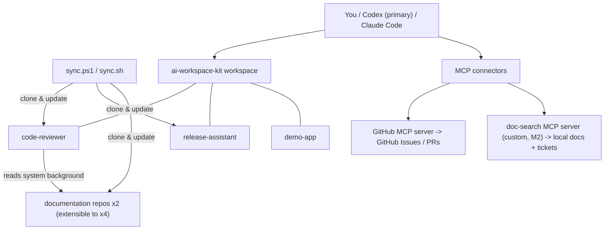

# ai-workspace-kit

[](https://github.com/cynthiawang109-sudo/ai-workspace-kit/actions/workflows/doc-search-tests.yml)

A **tool-agnostic AI development workspace**: a small meta-repo that checks out
a set of related repositories side by side — living documentation, a code
reviewer, a process assistant, and demo application code — so an AI coding
agent (Codex, Claude Code, or any client that reads `AGENTS.md` / speaks MCP)
can pull cross-repository context on demand instead of guessing.

This is a clean-room, public re-creation of a workspace pattern used in
production engineering work: documentation repos treated as the source of
truth, reviews and assistants consuming them through an index, and a one-command
sync that rebuilds the whole workspace anywhere.

The demo domain is **TaskFlow**, a fictional project-management SaaS. All
content is original and fictional — no employer code, data, or system names.

## Start here

New to the workspace? **[WALKTHROUGH.md](WALKTHROUGH.md)** is a guided,
copy-paste tour: sync the workspace, ask it questions across repos,
draft a ticket, get a pull request reviewed, run the digest demo, and
re-check a release gate — each step says what to type and what you
should see.

## Published documentation

The two documentation repos are also published as GitBook sites,
kept in sync with GitHub both ways (the repos stay the source of
truth):

- **TaskFlow Docs** — https://taskflow-1.gitbook.io/taskflow-docs/
  (system overview, deployment, incident runbook)
- **TaskFlow API Docs** — https://taskflow-1.gitbook.io/taskflow-docs-1/
  (API conventions, data model)

## Architecture



## Layout

| Path | What it is |
|---|---|
| `sync.ps1` / `sync.sh` | Materialize the pinned versions of every repo in `repos.txt` into `projects/` |
| `doctor.ps1` / `doctor.sh` | One-command health check: layout, sub-repo git state and pins, doc-search venv, Codex MCP registration, token presence |
| `versions.txt` | Main-branch SHAs of the last verified sub-repo combination |
| `repos.txt` | The workspace manifest: one `name url` pair per line |
| `AGENTS.md` | Workspace conventions every agent session follows (read order, cross-repo references, write governance) |
| `CLAUDE.md` | Thin pointer to `AGENTS.md` so Claude clients land in the same place |
| `.codex/config.toml.example` | MCP server registration template — secrets come from environment variables, never from this repo |
| `mcp/` | The custom `doc-search` MCP server (milestone M2) |
| `projects/` | Synced checkouts (git-ignored; each is its own repository) |

Synced projects:

| Directory | Purpose |
|---|---|
| `projects/taskflow-docs/` | TaskFlow system documentation (overview, deployment, runbook) |
| `projects/taskflow-api-docs/` | TaskFlow API conventions and data model |
| `projects/code-reviewer/` | Review standards, per-project review notes, documentation index |
| `projects/release-assistant/` | Release checklists and change-process documentation |
| `projects/demo-app/` | Demo FastAPI service the other repos describe and review |

## Quick start

```powershell
git clone https://github.com/cynthiawang109-sudo/ai-workspace-kit
cd ai-workspace-kit
.\sync.ps1            # or ./sync.sh in Git Bash / Linux / macOS
```

Then open the folder in your agent (Codex: `codex`, or the VS Code extension;
Claude Code works too) and ask something that needs more than one repo, e.g.
*"Where is demo-app's health-check contract defined, and does the
implementation follow it?"* — the answer lives in `taskflow-api-docs`, the code
in `demo-app`.

Run `.\doctor.ps1` (or `./doctor.sh`) any time to check whether this machine's
setup is complete: it verifies the layout, each checkout's git state, the
doc-search virtual environment, Codex's MCP registrations, and that the
GitHub token variable is set (presence only — it never prints secrets).

## Reproducible sync

`versions.txt` pins the main-branch SHAs of the last verified combination,
in `repos.txt` order. demo-app release tags live in demo-app and are independent
of these workspace pins.

Run `./sync.sh` or `.\sync.ps1` to clone missing repos and move clean checkouts
to their pins. Pins at the remote main tip stay attached to `main`; older pins
use detached HEAD. Dirty checkouts are warned about and skipped without being
touched. Every repo must have a pin. Doctor verifies each checkout against it.

After merging sub-repo work, run `./sync.sh --update-pins` or
`.\sync.ps1 -UpdatePins` to fetch `origin/main` and print and record changed
pins without moving checkouts. Both modes support the substring filter
(`./sync.sh docs --update-pins` or `.\sync.ps1 -Only docs -UpdatePins`).
Run sync to materialize the new pins, verify the combination, then commit
`versions.txt` so other machines reproduce it.

## Design notes

- **Index + on-demand fetch, not embeddings.** The reviewer keeps a small
  index of the documentation repos (`code-reviewer/context/doc-repos.md`) and
  fetches the specific file it needs. Cheap, inspectable, and always current.
- **Every project works standalone.** Cross-references are optional by
  convention: "if `../<sibling>` exists, use it for X" — nothing hard-requires
  the full workspace.
- **Draft-first writes.** Agents may read freely, but any outward write (issue,
  PR comment, ticket) is drafted for human approval first, then verified after
  posting. See `AGENTS.md`.
- **Secrets live outside the repo.** Tokens are read from environment
  variables; only `*.example` templates are committed.

## Roadmap

- **M1** — workspace skeleton: meta-repo, sync scripts, doc repos, demo app ✅
- **M2** — custom `doc-search` MCP server (Python / FastMCP): keyword search +
  fetch over the documentation repos and local Markdown tickets ✅
- **M3** — code-reviewer on a real pull request (GitHub Actions + Codex review)
- **M4** — case study: the production pattern this recreates, its trade-offs,
  and what transfers to other teams
